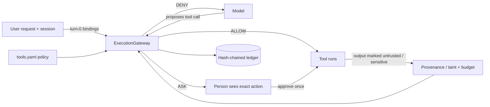

# Pehredaar

*Pehredaar* (पहरेदार) means "watchman". It is a small, tested Python reference for one idea:

> **The model proposes. The system decides.**

An AI agent's model suggests tool calls ("read this ticket", "refund $450 to this account").
Pehredaar sits between that suggestion and the real tool. Plain, deterministic code checks
each call against rules you wrote in advance, then **allows** it, **denies** it, or **asks a
person**. Every decision goes into a tamper-evident log.

This repository accompanies the talk **"A Guardrail Blueprint for Production AI Agents"**.
It is alpha software and a blueprint for learning and design reviews. It is not a
drop-in product. See [What this is not](#what-this-is-not).

---

## Why this exists, in two minutes

Language models follow instructions, and they cannot reliably tell *your* instructions from
instructions hidden in the data they read: a support ticket, a web page, a code comment, an
MCP tool description. This is **prompt injection**. Research in 2025 showed that adaptive
attackers get past published prompt-injection defenses most of the time. So the safe
assumption is:

**Assume the model can be tricked. Make sure a tricked model cannot do much damage.**

The danger is a combination that Simon Willison calls the **lethal trifecta**. An agent that
has all three of these can be turned against you:

1. access to **private data** (customer records, secrets)
2. exposure to **untrusted content** (tickets, emails, web pages)
3. a way to **act or send data out** (refunds, HTTP calls, running code)

Pehredaar shows how to cut that combination at execution time, using code instead of hope.

## What it checks

You describe each tool in `tools.yaml`: its effect (read or write), typed arguments with
limits, the permission scope it needs, whether its output is `trusted`, `untrusted` or
`sensitive`, and whether it can reach the network. Then every proposed call goes through
these checks, in this order. In rows 2 to 13 the first one that fires decides; rows 14 and 15
can still turn an ALLOW or ASK into a DENY. Rows 2 to 13 are `guardrails/policy.py:evaluate()`;
the rest are in `guardrails/gateway.py`:

| # | Check | Plain-English meaning | Rule id (verdict) |
| --- | --- | --- | --- |
| 1 | Registered tool | Unknown tools are never run | `policy.unregistered_tool` (deny) |
| 2 | Provenance present | The caller must say where the context came from | `policy.provenance_missing` (ask) |
| 3 | Identity | A principal must be named | `policy.identity` (deny) |
| 4 | Scope | The principal must hold the tool's permission | `policy.scope` (deny) |
| 5 | Typed arguments | Type, finite numbers, range, pattern, length and path limits | `policy.arguments` (deny) |
| 6 | Intent capsule | Values bound at turn 0 (e.g. the customer id) cannot change | `policy.capsule` (deny) |
| 7 | Budget | A run gets only so many actions | `policy.budget` (deny) |
| 8 | Lexical intent (optional) | Off-task writes deny, off-task reads ask. A weak signal | `policy.intent` |
| 9 | Lethal trifecta | Untrusted input plus sensitive data cannot reach a network tool | `policy.trifecta` (deny) |
| 10 | Tainted write | A write after reading untrusted content needs a person | `policy.taint_write` (ask) |
| 11 | Approval rules | `approval: always`, or `when_tainted` | `policy.approval_*` (ask) |
| 12 | Thresholds | An argument above `ask_above` needs a person | `policy.threshold` (ask) |
| 13 | Irreversible write | A write marked `reversible: false` needs a person | `policy.irreversible` (ask) |
| 14 | Egress allowlist | URL arguments must match a path-scoped allowlist | `sandbox.egress_path` (deny) |
| 15 | Custom checks | Your own predicate, such as "refund only to the verified IBAN" | e.g. `policy.iban` (deny) |
| 16 | Write budget | A run gets only so many writes, checked before an approval is spent | `policy.budget` (deny) |

If policy fails with an exception, the verdict is `policy.internal_error` (deny). After a
successful call, the tool's `output_trust` is folded into the run: `untrusted` taints it and
`sensitive` marks it as holding private data, which is what makes rows 9 and 10 fire later.

It also **pins MCP tool definitions** by hash (a changed tool description is dropped before
the model sees it), runs **generated code in a locked container** (no network, read-only, no
host environment), and records every decision in a **hash-chained ledger** that detects edits.

---

## Quick start (macOS, Windows, Linux)

### 1. Install the prerequisites

| Tool | Why | macOS / Linux | Windows (PowerShell) |
| --- | --- | --- | --- |
| [git](https://git-scm.com/downloads) | get the code | `brew install git` or your package manager | `winget install --id Git.Git -e` |
| [uv](https://docs.astral.sh/uv/getting-started/installation/) | Python and dependencies | `curl -LsSf https://astral.sh/uv/install.sh \| sh` | `powershell -ExecutionPolicy ByPass -c "irm https://astral.sh/uv/install.ps1 \| iex"` |
| [Docker Desktop](https://docs.docker.com/get-started/get-docker/) | *optional*, only for the container scene | install, then start it | install with the WSL 2 backend, keep **Linux containers** selected, then start it |

You do not need to install Python yourself. `uv` downloads Python 3.11+ if needed. After
installing `uv`, open a **new** terminal so it is on your PATH.

### 2. Get the code and install

The commands are identical in macOS Terminal, Linux shells, Windows PowerShell and WSL:

```console
git clone https://github.com/lxminarayn/pehredaar.git
cd pehredaar
uv sync --extra dev
uv run pytest
```

You should see all tests pass. Container tests are **skipped** if Docker is not running;
that is expected.

### 3. Run the demo

The demo is **OpsTriage**, a customer-support agent with four tools:

| Tool | What it touches | Trifecta leg |
| --- | --- | --- |
| `read_support_ticket` | text written by any customer | untrusted input |
| `query_customer_db` | names, emails, card tokens | private data |
| `issue_refund` | moves (fake) money | acts |
| `run_diagnostic_script` | runs Python, can reach the network | acts, sends out |

The tickets contain prompt-injection attacks. The model is **simulated**: its tool proposals
are fixed so the demo repeats exactly, and it plays a model that has been fully fooled. The
policy code, approval store, ledger and container are **real**. Customers, payments and the
network are **simulated**. No real money or data is involved.

**a. Without guardrails.** Every attack goes through:

```console
uv run python -m examples.ops_triage.agent --mode vulnerable
```

**b. With guardrails.** The same proposals are denied one by one. One refund stops and asks
**you** to approve it. Read the "model claims" line against the "action preview" line, then
type `y` or `n`:

```console
uv run python -m examples.ops_triage.agent --mode guarded
```

**c. With a real container** (Docker running). Scene A5 sends code that slips past the cheap
static check; the container still blocks the network and hides host secrets:

```console
docker pull python:3.13-alpine
uv run python -m examples.ops_triage.agent --mode guarded --image python:3.13-alpine
```

**d. Read the audit log, then tamper with it.** Keep the ledger in a known folder, print it,
edit one line, and print it again:

```console
uv run python -m examples.ops_triage.agent --mode guarded --approver approve --state-dir .pehredaar/opstriage
uv run agent-guardrails ledger --run all --path .pehredaar/opstriage/ledger.jsonl
```

Open `.pehredaar/opstriage/ledger.jsonl` in any editor, change one `"DENY"` to `"ALLOW"`,
save, and run the `ledger` command again. The last line changes from `integrity: VERIFIED` to
`integrity: TAMPERED`. Re-running the agent with `--state-dir` starts a fresh ledger.

**e. The whole idea in under 100 lines:**

```console
uv run python examples/quickstart.py
```

| Flag | Meaning |
| --- | --- |
| `--mode vulnerable \| guarded` | without or with Pehredaar |
| `--approver console \| approve \| reject` | ask at the terminal (default; no answer means reject), or a labelled scripted answer |
| `--image IMAGE` | run diagnostics in a container; also enables scene A5. Pin a digest for anything you keep, e.g. `python:3.13-alpine@sha256:...` |
| `--state-dir DIR` | keep the ledger and approvals in `DIR` (wiped at start) instead of a temp folder |

On Windows you can set the image once with `$env:OPS_TRIAGE_IMAGE = "python:3.13-alpine"`;
on macOS and Linux use `export OPS_TRIAGE_IMAGE=python:3.13-alpine`.

---

## How it works



The repository is organised by the five separations from the talk:

| Separation | Where in the code | OWASP Agentic Top 10 (2026) |
| --- | --- | --- |
| 1. Agent loop and context | `guardrails/taint.py`, `RunContext.bindings` | ASI01, part of ASI06 |
| 2. Tools and identity | `guardrails/registry.py`, `identity.py`, `manifest.py` | ASI03, ASI04 |
| 3. Runtime policy | `guardrails/policy.py`, `gateway.py`, `budget.py` | ASI02, part of ASI08 |
| 4. Isolation | `guardrails/sandbox.py` | ASI05 |
| 5. Human approval and audit | `guardrails/approval.py`, `ledger.py` | ASI09 |

ASI07 (inter-agent communication) and ASI10 (rogue agents) need platform support and are not
covered. The mapping is the author's reading, not an OWASP certification.

### Repository map

| Path | What it is |
| --- | --- |
| `guardrails/` | the library: policy, gateway, taint, approvals, ledger, sandbox, hooks |
| `examples/ops_triage/` | the talk demo (support agent, tools, poisoned tickets, MCP lock file) |
| `examples/quickstart.py` | smallest end-to-end example |
| `demo/`, `attacks/` | extended demo: a coding agent plus a 26-case attack corpus and scorecard |
| `templates/` | starter `tools.yaml`, `sandbox.yaml`, threat model for your own project |
| `presentation/index.html` | the talk slides, a single self-contained file |
| `docs/` | architecture, adoption guide, limitations, ecosystem comparison, threat model |
| `tests/` | 70+ tests, including checks that slide text matches what the code prints |

---

## Use it in your own agent

### Python agents

Route **every** tool call through one gateway. It evaluates and dispatches in one place, so
there is no gap between the check and the action:

```python
from pathlib import Path

from guardrails.approval import ApprovalStore
from guardrails.budget import Budget
from guardrails.gateway import ActionDenied, ApprovalRequired, ExecutionGateway, RunContext
from guardrails.ledger import Ledger
from guardrails.registry import load_registry
from guardrails.taint import Provenance

root = Path.cwd()
gateway = ExecutionGateway(
    registry=load_registry(root / "tools.yaml"),
    workspace=root,
    ledger=Ledger(root / ".pehredaar" / "ledger.jsonl"),
    approvals=ApprovalStore(root / ".pehredaar" / "approvals"),
)
run = RunContext(
    run_id="run-42",
    principal="user:42",  # from your authenticated session
    scopes=frozenset({"tickets:read", "refunds:write"}),
    original_request="refund the duplicate charge on T-402",
    provenance=Provenance.trusted(),
    budget=Budget(action_limit=20, write_limit=5),
    bindings={"customer_id": "CUST-101"},  # fixed at turn 0, never from the model
)
try:
    result = gateway.execute(run, tool_name, tool_args, dispatch)
except ApprovalRequired as pending:
    ...  # show the exact arguments to a person; gateway.approvals.decide(...) then retry
except ActionDenied as denied:
    ...  # return denied.decision.rule_id to the model as the tool result
```

Extras: `egress_profile=` denies URL arguments that are not on a path-scoped allowlist, and
`checks={"issue_refund": Check(...)}` adds your own deterministic predicate. See
[docs/ADOPT.md](docs/ADOPT.md) for the full walkthrough.

### Coding-agent harnesses (command hooks)

Install the command, then scaffold a project:

```console
uv tool install .
agent-guardrails init --path ../my-agent --harness claude      # or: copilot, vscode-local
agent-guardrails doctor --path ../my-agent
```

`init` scans your project for tool definitions and writes `tools.yaml`, `sandbox.yaml` and the
harness hook file. Generated tools keep `scope` and `reversible` as `TODO`, and `tools.yaml`
will not load until you decide them. **Test one known denial before relying on a hook.**

| Integration | Status | Notes |
| --- | --- | --- |
| Python executor | Supported | `ExecutionGateway.execute()` before dispatch |
| Claude Code | Supported | `UserPromptSubmit`, `PreToolUse`, `PostToolUse` hooks; generated pre-tool hook sets `onFailure: block` (Claude Code 2.1.295+), so a crashed hook denies |
| GitHub Copilot CLI / Agent Host | Supported | `.github/hooks/*.json`, version 1, PascalCase events (Copilot's VS Code-compatible mode). Hook timeouts are fail-open |
| GitHub Copilot cloud agent | Conditional | Put the command in the job image; no user present, so ASK becomes DENY |
| VS Code Local harness | Preview, deprecated | VS Code plans to remove the Local harness in February 2027 |
| Codex, OpenAI Agents SDK, MCP proxy | Not included | Use the Python gateway around your own dispatch, or native guardrails |

---

## What this is not

Be clear about this before you copy anything into production:

- **Not a prompt-injection detector.** It does not try to spot malicious text. It limits what
  any text can cause.
- **Not a complete sandbox.** Only calls routed through the gateway or a hook are checked. A
  subprocess can open its own sockets. Containers share the host kernel; use gVisor or a microVM
  for hostile code.
- **Not enterprise identity.** Scopes are passed in by the caller. Hook mode uses a local
  principal. There is no OAuth, revocation or delegation proof.
- **Coarse taint.** Once untrusted output is read, the whole run is tainted. It cannot follow
  data through model paraphrasing.
- **Local state.** Approvals and the ledger are local files. The ledger detects edits but not
  deletion of the whole file, and it is not signed.
- **The demo model is simulated**, and the scorecard below is a deterministic simulation, not a
  benchmark of real attacks against a real model.

Full list: [docs/LIMITATIONS.md](docs/LIMITATIONS.md). Related projects and when to prefer them:
[docs/ECOSYSTEM.md](docs/ECOSYSTEM.md).

## From blueprint to production

What you would still add for a real deployment:

1. **Identity**: per-agent workload identity and OAuth on-behalf-of tokens, scoped and
   short-lived, so the agent acts *as the user* with *less* than the user's rights.
2. **Policy at scale**: express the same rules in OPA or Cedar, review them like code, and
   test known denials in CI.
3. **Isolation**: gVisor or a microVM sandbox for generated code, and an egress proxy that
   enforces the URL allowlist at the network layer.
4. **MCP hygiene**: pin tool definitions, review the lock file, and prefer a gateway that
   applies policy to every MCP call.
5. **Human review that scales**: an approval service with authenticated approvers, showing
   literal actions, used only for money, egress and irreversible writes.
6. **Assurance**: red-team in CI (garak, PyRIT, promptfoo, AgentDojo-style suites), traces of
   every tool call, alerts on denials, and audit records in write-once storage.

## Extended demo and scorecard

`demo/` holds a second, offline demo: a coding agent fixing a billing bug while a poisoned
issue tries to leak fake deploy secrets, revealed one guardrail plane at a time.

```console
uv run agent-guardrails demo step 0 --no-color      # baseline: the leak happens
uv run agent-guardrails demo all --no-color         # all steps
uv run agent-guardrails attack --all --report --no-color
uv run agent-guardrails demo reset                  # restore demo/workspace
```

`attack --all --report` prints:

```text
plane added                 attack success   benign completion
none (baseline)                       1.00                1.00
1 tools.yaml                          0.88                1.00
2 policy.py                           0.38                0.81
3 intent_check.py                     0.23                0.81
4 sandbox.yaml                        0.12                0.81
5 approval + ledger                   0.08                0.77
content scanner only                  0.23                0.92
  on adaptive variants                1.00                0.92
```

The plane rows are a deterministic simulation over declared attack signals. The scanner rows
run a real toy keyword scanner against the payloads: it catches most of the corpus and none
of the adaptive variants, which is why this design does not rely on content inspection. Note
the price: benign completion falls to 0.77 with every plane on.

## Slides

Open [presentation/index.html](presentation/index.html) in any modern browser. It is one
self-contained file and works offline.

| Key | Action |
| --- | --- |
| Right, Space, PageDown, click | next step or slide |
| Left, PageUp | back |
| F | fullscreen |
| B or `.` | black screen (press again to return) |
| T | show or hide the elapsed-time clock |
| `1` `0` then Enter (or `G`) | jump to slide 10 |
| `#7` at the end of the URL | open at slide 7 |

The terminal text on the demo slides is condensed from `docs/recordings/opstriage-*.txt`;
`tests/test_opstriage.py` fails if those recordings drift from the code. Regenerate them with
`make opstriage-snapshots` (or run the two commands in the `Makefile` directly on Windows).

## Troubleshooting

| Symptom | Fix |
| --- | --- |
| `uv: command not found` / not recognised | open a new terminal after installing uv |
| `failed to connect to the docker API` | start Docker Desktop and wait until it says it is running |
| `container engine failed` on Windows | Docker Desktop must use **Linux containers** (WSL 2 backend) |
| first container run is slow | run `docker pull python:3.13-alpine` once beforehand |
| `make` not found on Windows | run the `uv run ...` commands from this README; `make` is optional |
| the guarded demo waits for input | it is asking you to approve a refund; type `y` or `n` |

## Development

```console
uv run ruff format --check .
uv run ruff check .
uv run mypy
uv run pytest
uv run python scripts/secret_scan.py
uv run agent-guardrails verify-recordings
uv run python scripts/bench_policy.py   # local latency micro-benchmark quoted on the slides
```

CI runs all of these on Linux, macOS and Windows. See [CONTRIBUTING.md](CONTRIBUTING.md) and
[SECURITY.md](SECURITY.md).

## Further reading

- OWASP GenAI Security Project, *Top 10 for Agentic Applications (2026)*
- Simon Willison, *The lethal trifecta for AI agents* (2025)
- Meta AI, *Agents Rule of Two* (2025)
- Nasr, Carlini, Tramèr et al., *The Attacker Moves Second* (2025)
- Beurer-Kellner et al., *Design Patterns for Securing LLM Agents against Prompt Injections* (2025)
- Debenedetti et al., *Defeating Prompt Injections by Design* (CaMeL, 2025)
- ASD's ACSC, CISA, NSA and partners, *Careful adoption of agentic AI services* (2026)
- [docs/ECOSYSTEM.md](docs/ECOSYSTEM.md): how this fits next to evals, scanners, policy engines and sandboxes

## License

MIT. See [LICENSE](LICENSE).
