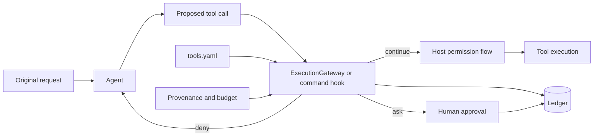

# Architecture

## Boundary

Pehredaar separates proposal from execution.

The low-level policy returns `ALLOW`, `DENY`, `ASK`, or `TRANSFORM`. The gateway treats
`TRANSFORM` as denied because no transform contract is implemented.

## Decision order

`guardrails.policy.evaluate()` checks, in this order:

1. provenance exists (missing provenance asks)
2. a principal is present (an empty principal denies; the caller authenticates who it is)
3. the principal's scopes include the tool's scope
4. arguments satisfy the schema (types, finite numbers, bounds, patterns, path roots)
5. intent-capsule bindings fixed at turn 0 still hold
6. action budget remains
7. optional lexical intent matches (off-task writes deny, off-task reads ask)
8. the lethal trifecta: untrusted input plus sensitive data cannot reach an egress tool
9. untrusted data does not cross a write without approval
10. the tool's `approval: always` rule
11. the tool's `approval: when_tainted` rule
12. `ask_above` argument thresholds
13. irreversible writes ask

Exceptions return DENY. The gateway then applies the egress allowlist and any per-tool
`Check` predicate before dispatch, and after a successful call it folds the tool's
`output_trust` (`untrusted` or `sensitive`) back into the run provenance.

## Execution gateway

`ExecutionGateway` joins policy and enforcement for Python agents. It owns:

- tool lookup
- intent signal evaluation
- budget reservation
- approval creation and single-use consumption
- ledger append
- dispatch

A caller cannot receive an ALLOW result and accidentally ignore it because dispatch is part
of the same method.

## Command hook

`HookRuntime` supports harnesses that send JSON before and after tool calls. It stores one
state file per session:

- original request
- actions and writes reserved
- taint flag and origins

`UserPromptSubmit` starts a new action budget and records the new request. It keeps the taint and
sensitivity labels, because earlier tool output can still be in the model's context. Start a new
session for a clean slate. `PreToolUse` decides and reserves budget. `PostToolUse`
marks configured outputs as untrusted. State writes and ledger appends use local advisory
locks and atomic replacement.

ALLOW produces no vendor decision. This preserves the host permission flow. ASK and DENY
produce the documented `PreToolUse` decision object.

## Tool policy

`tools.yaml` is strict. Unknown fields and invalid enum values fail loading. Argument types:

- `string`
- `integer`
- `number`
- `boolean`
- `path`
- `enum`

Bounds include minimum, maximum, `ask_above` threshold, maximum length, regex full match,
one path root, or several path roots. Paths resolve symlinks before containment checks and
relative paths resolve from the host `cwd`, never widening the allowed roots.

`output_trust: untrusted` taints later calls; `output_trust: sensitive` marks the run as
holding private data. A tool with `egress: true` cannot run once the context is both
tainted and sensitive.

## Local state

Approvals and ledger files use advisory file locks on Windows and POSIX. Approval updates
use atomic replacement. Approved actions are consumed once. Ledger append locks the tail
read and the write as one operation, and each record carries a millisecond timestamp and
its taint labels.

These guarantees apply to local filesystems. Use a database or transactional service on a
shared network filesystem.

## Isolation profile

`sandbox.yaml` describes desired filesystem, credential, and egress policy.
`guardrails.sandbox` provides three things: URL validation (canonical percent encoding and
dot segments, rejecting credentials and fragments, checking scheme, host, port, and path);
`static_gate`, an AST pre-filter for host and network modules; and `run_python`, which runs
generated code in a throwaway container with no network, no host environment variables, a
read-only root, dropped capabilities, and memory and process limits. A container that exceeds
its timeout is removed by name, and the output returned to the caller is capped.

The static gate and the container are layered on purpose. A snippet that passes the gate, for
example one that imports `_socket`, still hits `--network=none`. The OpsTriage scene A5 shows
this with a real container.

`guardrails.manifest` pins the `(name, description, inputSchema)` of MCP tools so a changed
description or schema is dropped before the model sees it. Dropping must also remove the tool
from the callable registry, as OpsTriage does. Printing a rejection while leaving the tool
registered would not stop a fabricated call.

Container, gVisor, and microVM selection remain a deployment choice.

## Independence

`guardrails/` imports no demo, example, or model SDK. Tests reject LLM and demo imports in
the policy path. Each toolkit module stays below 300 lines.
